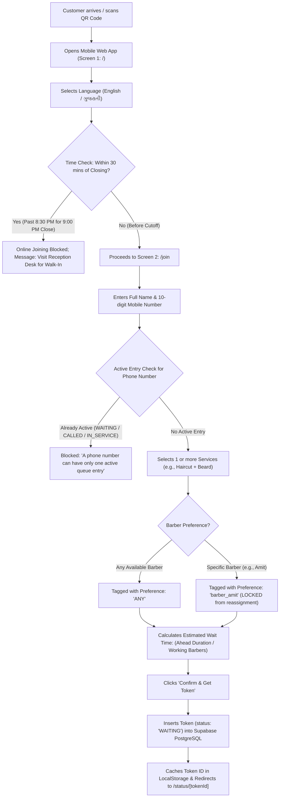
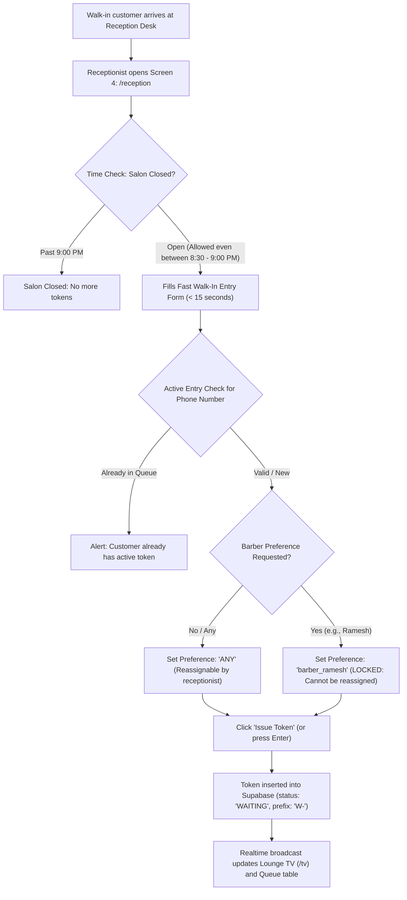
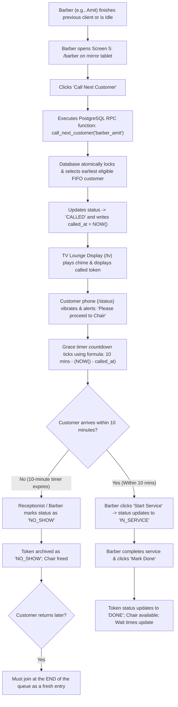

# Salon Queue Management System — Business Flows, Queue Rules & Test Cases

**Project Name:** Trim & Tone Salon Queue Management System (ટ્રિમ અને ટોન સલૂન કતાર વ્યવસ્થાપન)  
**Academic Context:** MSc IT — Vibe Coding Lab Project  
**Developer:** Neha Tadvi (Student ID: 202612123)  
**Course:** MSc IT  
**Institute:** DAU (DAIICT)  
**Version:** 1.3.0 (Atomic Transactions, RLS Policies & Database Timestamp Architecture)  

---

## 1. End-to-End Operational Flows

### 1.1 Customer Self-Service Digital Joining Flow


### 1.2 Receptionist Walk-In Customer Flow


### 1.3 Barber Service Execution Flow (Atomic Dispatch & Grace Calculation)


---

## 2. Queue State Machine & Standardized Statuses

Every customer token strictly transitions through deterministic finite states using the **six canonical statuses**:

```
[ CREATED ] 
     │
     ▼
[ WAITING ] ────────────► [ CANCELLED ] (Customer self-cancels from mobile)
     │
     ▼ (Atomic RPC: call_next_customer; sets called_at = NOW())
 [ CALLED ] ────────────► [ NO_SHOW ]   (Customer does not arrive within 10 min of called_at)
     │                                        │
     │                                        ▼
     │                                  [ MUST REJOIN AT END OF QUEUE ]
     ▼ (Customer takes seat at chair within 10 mins)
[ IN_SERVICE ]
     │
     ▼ (Barber completes haircut/grooming)
  [ DONE ]
```

### 2.1 Standardized State Definitions & Invariants
| State | Trigger / Actor | Invariants & System Actions |
| :--- | :--- | :--- |
| **`WAITING`** | Customer / Receptionist | Token has assigned sequence number, services, and `created_at` timestamp. Ordered strictly by FIFO. Included in wait-time calculation. |
| **`CALLED`** | Barber / Receptionist via Atomic RPC | Token summoned to chair. **Database sets `called_at = NOW()`**. 10-minute countdown active. Lounge TV triggers chime. |
| **`IN_SERVICE`** | Barber | Customer is in the chair within the 10-minute grace window. Active service stopwatch running. Barber state is `BUSY`. |
| **`DONE`** | Barber / Receptionist | Service finished successfully. Token archived. Chair liberated. Barber switches to `AVAILABLE`. Metrics updated. *(Replaces legacy `COMPLETED`)*. |
| **`NO_SHOW`** | Receptionist / Timer | Customer did not report within 10 minutes of `called_at`. Removed from chair and active queue. **If customer returns later, they must join at the end of the queue.** |
| **`CANCELLED`** | Customer / Receptionist | Customer self-cancelled while in `WAITING` state. Removed immediately from queue calculations. |

---

## 3. Database Schema, Entity Models & RLS Policies

### 3.1 Token Entity Schema (`tokens` Table)
```typescript
interface Token {
  id: string;              // UUID Primary Key
  display_token: string;   // Formatted token e.g. "A-101" or "W-102"
  customer_name: string;   // e.g. "Bhavin Patel"
  phone_number: string;    // e.g. "9825012345" (unique among active tokens)
  service_ids: string[];   // Array of foreign keys to services table
  total_duration_minutes: number; // Sum of service durations (e.g. 40)
  total_price: number;     // Sum in INR (e.g. 400)
  barber_preference: 'ANY' | string; // 'ANY' or barber UUID
  is_locked_to_barber: boolean; // TRUE if specific barber requested (CANNOT be reassigned)
  assigned_barber_id: string | null;  // Barber handling the chair
  chair_number: number | null;       // Station 1, 2, 3, 4
  status: 'WAITING' | 'CALLED' | 'IN_SERVICE' | 'DONE' | 'CANCELLED' | 'NO_SHOW';
  created_at: string;      // ISO 8601 timestamp (basis for FIFO ordering)
  called_at: string | null; // Database TIMESTAMPTZ when CALLED (basis for 10-min grace countdown)
  started_at: string | null;
  done_at: string | null;
}
```

### 3.2 Row Level Security (RLS) Policies
To ensure production-grade security, the application **never exposes the service-role key** in frontend code. Only the public `NEXT_PUBLIC_SUPABASE_ANON_KEY` is loaded on client devices, governed by strict RLS policies:

```sql
-- 1. Enable RLS on all tables
ALTER TABLE tokens ENABLE ROW LEVEL SECURITY;
ALTER TABLE barbers ENABLE ROW LEVEL SECURITY;
ALTER TABLE services ENABLE ROW LEVEL SECURITY;
ALTER TABLE salon_settings ENABLE ROW LEVEL SECURITY;

-- 2. Public Read Policies (All users can view active queue, barbers, and services)
CREATE POLICY "Public read access for active tokens"
  ON tokens FOR SELECT
  USING (true);

CREATE POLICY "Public read access for barbers"
  ON barbers FOR SELECT
  USING (true);

CREATE POLICY "Public read access for services"
  ON services FOR SELECT
  USING (true);

CREATE POLICY "Public read access for salon settings"
  ON salon_settings FOR SELECT
  USING (true);

-- 3. Customer Token Insertion Policy (Anon can join queue with initial status WAITING)
CREATE POLICY "Public insert token policy"
  ON tokens FOR INSERT
  WITH CHECK (
    status = 'WAITING' 
    AND called_at IS NULL 
    AND started_at IS NULL 
    AND done_at IS NULL
  );

-- 4. Customer Self-Cancellation Policy (Anon can cancel own token if currently WAITING)
CREATE POLICY "Customer self cancel policy"
  ON tokens FOR UPDATE
  USING (status = 'WAITING')
  WITH CHECK (status = 'CANCELLED');
```

---

## 4. Atomic "Call Next" Stored Procedure (RPC)

To guarantee that two barbers clicking "Call Next" at the exact same millisecond never summon the same customer (preventing concurrency race conditions), the operation is encapsulated in a PostgreSQL stored procedure using `FOR UPDATE SKIP LOCKED`.

### 4.1 SQL RPC Function: `call_next_customer`
```sql
CREATE OR REPLACE FUNCTION call_next_customer(p_barber_id TEXT)
RETURNS SETOF tokens AS $$
DECLARE
  v_token_id UUID;
BEGIN
  -- 1. Atomically find and lock the earliest eligible FIFO customer
  SELECT id INTO v_token_id
  FROM tokens
  WHERE status = 'WAITING'
    AND (barber_preference = 'ANY' OR barber_preference = p_barber_id)
  ORDER BY created_at ASC
  LIMIT 1
  FOR UPDATE SKIP LOCKED;

  -- 2. If an eligible customer exists, atomically update their state
  IF v_token_id IS NOT NULL THEN
    RETURN QUERY
    UPDATE tokens
    SET 
      status = 'CALLED',
      assigned_barber_id = p_barber_id,
      called_at = NOW()
    WHERE id = v_token_id
    RETURNING *;
  END IF;
  
  RETURN;
END;
$$ LANGUAGE plpgsql SECURITY DEFINER;
```

---

## 5. Database-Driven 10-Minute Grace Period Calculation

The 10-minute grace period must never rely on ephemeral in-memory JavaScript timers that reset on page reload. Instead, it is computed deterministically from the database `called_at` timestamp:

### 5.1 Grace Period Mathematical Formula
For any token with `status === 'CALLED'`:
$$\text{Elapsed Seconds} = \text{Current Time (Epoch Seconds)} - \text{called\_at (Epoch Seconds)}$$
$$\text{Remaining Grace Seconds} = \max\left(0, 600 - \text{Elapsed Seconds}\right)$$

### 5.2 Client-Side Calculation Utility
```typescript
export function getRemainingGraceSeconds(calledAt: string | null): number {
  if (!calledAt) return 0;
  const calledTimeMs = new Date(calledAt).getTime();
  const nowMs = Date.now();
  const elapsedSeconds = Math.floor((nowMs - calledTimeMs) / 1000);
  const remainingSeconds = 600 - elapsedSeconds; // 600 seconds = 10 minutes
  return Math.max(0, remainingSeconds);
}
```
**Benefits:**
- **Refresh Proof:** If the customer refreshes their mobile browser 4 minutes after being called, the timer resumes at 6:00 remaining.
- **Device Independent:** The lounge TV, receptionist dashboard, and customer phone all compute identical remaining grace times based on the single source of truth in PostgreSQL.

---

## 6. Waiting-Time Calculation Engine

The system strictly implements the waiting-time calculation formula specified in the project guide:

### 6.1 The Guide's Formula
$$\text{Estimated Wait Time (minutes)} = \frac{\text{Total Estimated Service Duration of Customers Ahead}}{\text{Number of Working Barbers}}$$

### 6.2 Component Definitions
1. **Customers Ahead:** All customer tokens currently in `WAITING` status who were created before the target token in the FIFO order, plus any remaining time for clients currently `IN_SERVICE`.
2. **Total Estimated Service Duration of Customers Ahead:**
   $$\sum_{i \in \text{Ahead}} \text{Duration}(i)$$
3. **Number of Working Barbers ($N_{\text{working}}$):**
   - Count of all on-duty barbers whose current status is `AVAILABLE` or `BUSY`.
   - Barbers who are `ON_BREAK` (15m Chai Break or 30m Lunch Break) or `OFF_DUTY` are **excluded** from the denominator.
   - If $N_{\text{working}} = 0$, system displays: *"All barbers currently on break / unavailable. Please consult reception."*

---

## 7. Near-Real-Time Synchronization (Supabase WebSockets)

- **Synchronization Model:** Described strictly as **near-real-time synchronization** (typically sub-second, resilient to network fluctuations and device sleep/wake states).
- **Resilience:** If network connectivity temporarily drops on a mobile phone, Supabase's client automatically reconnects and re-synchronizes the active queue snapshot without requiring a manual page refresh.

---

## 8. Comprehensive Test Cases (12 Test Scenarios)

| Test ID | Test Scenario | Preconditions | Action / Input Steps | Expected Outcome | Pass/Fail Criteria |
| :---: | :--- | :--- | :--- | :--- | :--- |
| **TC-01** | Customer joins queue with "Any Available Barber" | Salon open (2:00 PM). 3 working barbers. Total service duration ahead = 60 mins. | 1. Open `/join`<br>2. Enter "Bhavin Patel", "9825011111"<br>3. Select Haircut (25m)<br>4. Select "Any Available"<br>5. Click "Confirm & Get Token" | Token `A-101` inserted with status `WAITING`. Saved in localStorage. Redirects to `/status/A-101`. EWT displays: $\frac{60}{3} = 20$ minutes. | Strict FIFO order; correct wait time calculated via guide formula. |
| **TC-02** | Customer joins queue with Specific Barber preference | Barber Amit is on duty. | 1. Open `/join`<br>2. Enter "Aarav Shah", "9825022222"<br>3. Select Haircut + Beard (40m)<br>4. Select "Barber: Amit"<br>5. Submit | Token `A-102` inserted. `barber_preference` is `barber_amit` and `is_locked_to_barber` is `true`. Displays stylist name Amit. | Reassignment locked; token explicitly bound to Amit. |
| **TC-03** | Single active phone number constraint (Duplicate blocked) | Customer with phone "9825011111" already holds active token `A-101` in `WAITING`. | 1. Open `/join`<br>2. Enter "Bhavin Patel", "9825011111"<br>3. Select Beard Trim<br>4. Submit | Submission blocked by database unique index and UI validator: *"A phone number can have only one active queue entry."* | No duplicate token created. Active token count remains 1. |
| **TC-04** | Atomic Barber Call Next (Race condition prevention) | Queue has: 1. Token 1 (wants Ramesh), 2. Token 2 (wants Amit), 3. Token 3 (wants Any). | Barber Amit finishes client and clicks "Call Next Customer". | Calls RPC `call_next_customer('barber_amit')`. Atomically skips Token 1; selects Token 2. Status updates to `CALLED`, `called_at = NOW()`. | Atomic selection; Token 1 remains in position 1. |
| **TC-05** | Simultaneous Barber Call Next Concurrency Test | Two barbers click "Call Next" at the exact same millisecond with 1 customer waiting. | Both barbers execute `call_next_customer` simultaneously. | Postgres row-level lock (`SKIP LOCKED`) assigns customer to Barber 1. Barber 2 receives NULL (no customer). | Zero double-assignments. Exactly one barber receives the customer. |
| **TC-06** | Specific barber reassignment restriction enforced | Token `A-102` has `is_locked_to_barber: true`. | Receptionist attempts to change barber to "Ramesh" on `/reception`. | Reassign action is disabled/locked. Tooltip: *"Customer requested a specific barber. Reassignment is not permitted."* | Receptionist cannot override specific customer preference. |
| **TC-07** | 10-Minute Grace Countdown Survival Across Refresh | Barber calls Token `A-103`. Status is `CALLED`, `called_at` written 4 mins ago. | Customer refreshes mobile browser on `/status/A-103`. | Page re-hydrates `called_at` from DB and computes remaining time as $600 - 240 = 360$ seconds (6:00 mins remaining). | Timer does not reset to 10:00; survives refresh perfectly. |
| **TC-08** | Customer returns after No-Show: Joins at end of queue | Token `A-103` was marked `NO_SHOW` 20 minutes ago. Customer returns to salon. | Customer or receptionist attempts to re-enter queue. | Customer cannot reclaim former position. Receptionist issues a new token at the **end of the queue**. Token starts as last in FIFO. | Returning no-show customer is placed at tail of line. |
| **TC-09** | Wait time recalculation when barber takes 15m Chai Break | Total service duration ahead = 90 mins. 3 working barbers. EWT = $\frac{90}{3} = 30$ mins. | Barber Jignesh toggles "15m Chai Break". Working barbers drops from 3 to 2. | Wait time near-real-time updates: $\frac{90}{2} = 45$ mins across all screens. | Denominator correctly reflects only active working barbers. |
| **TC-10** | Online queue cutoff 30 minutes before closing | Current salon time is 8:31 PM (closing is 9:00 PM). | 1. Customer visits `/join`<br>2. Attempts to submit form | Form is disabled. Alert displays: *"Online queue is closed for today. Walk-ins are still accepted at the reception desk until 9:00 PM."* | Online queue registration blocked 30 min before closing. |
| **TC-11** | Walk-in registration allowed within last 30 minutes | Current salon time is 8:45 PM (closing is 9:00 PM). | 1. Receptionist on `/reception` enters walk-in customer details.<br>2. Clicks "Issue Token". | Walk-in token created successfully (e.g., `W-108`). Added to FIFO queue. | Walk-ins permitted at reception up until official 9:00 PM closing. |
| **TC-12** | Barber service completion flips status to DONE | Barber completes haircut for seated client in chair 1. | Barber clicks "Mark Done" on `/barber`. | Status transitions from `IN_SERVICE` to `DONE`. Chair liberated. Next customer can be called. | Status is strictly `DONE` (not COMPLETED). Chair reset to available. |
